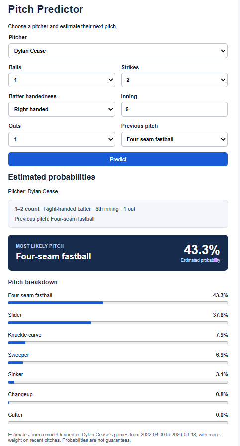

# Pitch Predictor

A machine learning application that estimates an MLB pitcher’s next pitch type from the current game situation.

The project includes a React interface, a FastAPI backend, and a reproducible workflow for downloading pitch data, training pitcher-specific models, and evaluating their predictions.

Currently available pitchers: Dylan Cease and Zack Wheeler.

**[Try the live demo](https://pitch-predictor-slfm.onrender.com/)**

The free backend may take about a minute to wake up after inactivity.



## Features

- Predict pitch-type probabilities from:
  - Balls and strikes
  - Batter handedness
  - Inning
  - Outs
  - Previous pitch type
- Select a pitcher from the available saved models.
- View previous-pitch options based on the selected pitcher’s repertoire.
- View ranked probabilities through a web interface or terminal.
- Download and cache MLB Statcast data.
- Train pitcher-specific models using up to five recent seasons, with greater weight on recent pitches.
- Evaluate predictions chronologically against simple baselines.
- Inspect performance by pitch type, count, and game.

## Tech Stack

| Component | Technology |
| --- | --- |
| Data collection | MLB Statcast through pybaseball |
| Data preparation | pandas |
| Machine learning | scikit-learn |
| Model persistence | joblib |
| Backend | FastAPI |
| Frontend | React, TypeScript, Vite |

## Model

The application uses a recency-weighted random forest with:

- 200 trees
- Maximum tree depth of 6
- Minimum leaf size of 20 samples
- One-hot encoding for batter handedness and previous pitch type
- A fixed random seed for reproducibility

Training uses regular-season pitches from **2022–2026**, with a one-year weighting half-life. A pitch that is 365 days older receives half as much weight.

The current data snapshot was requested through **October 27, 2026**. Training includes available pitches before October 28, 2026. The application does not automatically download live data or retrain.

Each pitcher has a separate saved model containing their name, pitch types, and training metadata:

​```text
models/pitcher_656302_v2.joblib
models/pitcher_554430_v2.joblib
​```

The API discovers available pitchers from these saved models. Prediction requests do not download data or retrain models.

## Evaluation Results

For **Dylan Cease**, a retrospective 2026 simulation evaluated 2,895 pitches across 29 games. Before each game, the updated predictors learned only from pitches on earlier dates..

| Predictor | Accuracy | Log loss ↓ |
| --- | ---: | ---: |
| Frozen random forest | 38.9% | 1.592 |
| Updated random forest | **39.1%** | **1.467** |
| Frozen situational baseline | 38.6% | 1.620 |
| Updated situational baseline | 38.4% | 1.475 |

For Zack Wheeler, the same evaluation procedure covered **2,649 pitches across 28 games**:

| Predictor | Accuracy | Log loss ↓ |
| --- | ---: | ---: |
| Frozen random forest | 39.0% | 1.486 |
| Updated random forest | **39.1%** | **1.450** |
| Frozen situational baseline | 38.4% | 1.495 |
| Updated situational baseline | 38.1% | 1.452 |

The situational baseline estimates pitch probabilities using the count and batter handedness, with recency weighting and smoothing.

Accuracy measures how often the most likely pitch matches the actual pitch. Log loss evaluates the full probability distribution; lower values are better.

The updated random forest slightly outperformed the updated situational baseline for both pitchers, although Wheeler’s log-loss difference was very small.

The 2026 results were examined during development, so they should be treated as retrospective evidence rather than an untouched final test.

## Project Structure

| Location | Purpose |
| --- | --- |
| `src/api.py` | API routes and request validation |
| `src/pitch_predictor.py` | Discover pitcher models and produce probabilities |
| `src/predict.py` | Interactive terminal predictions |
| `src/data.py` | Prepare pitch sequences and load training data |
| `src/model.py` | Model configuration, weighting, training, and saving |
| `src/evaluation.py` | Season simulation, baselines, and diagnostics |
| `scripts/data.py` | Download cached data and prepare the training snapshot |
| `scripts/train.py` | Train and save the deployment model |
| `scripts/evaluate.py` | Run evaluation or inspect saved predictions |
| `frontend/` | React interface |
| `data/` | Local datasets and evaluation outputs |
| `models/` | Local saved models |
| `tests/` | Automated data, model, and API tests |

## Local Setup

### 1. Create a Python environment

Run these commands from the project root:

```bash
python -m venv .venv
```

Activate it on Windows PowerShell:

```powershell
.\.venv\Scripts\Activate.ps1
```

Or on macOS/Linux:

```bash
source .venv/bin/activate
```

Install the Python dependencies:

```bash
python -m pip install -r requirements.txt
```

### 2. Prepare data and train (optional)

Saved models for Dylan Cease and Zack Wheeler are included in the repository, so you can skip this step to run the application.

To download data and retrain a pitcher’s model:

```bash
python -m scripts.data --pitcher-id 656302
python -m scripts.train --pitcher-id 656302
```

Use `554430` for Zack Wheeler. Omitting `--pitcher-id` defaults to Dylan Cease.

Downloads are cached by pitcher and season. For Cease, the prepared dataset and saved model are stored at:

```text
data/pitchers/656302/prepared_2022_2026.csv
models/pitcher_656302_v2.joblib
```

Downloading data and initially retrieving a pitcher’s name require internet access. Local datasets and evaluation outputs are excluded from Git.

### 3. Start the backend

From the project root:

```bash
python -m uvicorn src.api:app --reload
```

Interactive API documentation is available at:

http://127.0.0.1:8000/docs

### 4. Start the frontend

In a second terminal:

```bash
cd frontend
npm ci
npm run dev
```

Open the local URL printed by Vite.

The frontend development server forwards `/api` requests to the backend on port 8000. Both servers must be running for web predictions.

The development environment used Node.js 24.

## Adding a Pitcher

Use the pitcher’s MLB player ID with the existing commands:

```bash
python -m scripts.data --pitcher-id <MLB_PLAYER_ID>
python -m scripts.train --pitcher-id <MLB_PLAYER_ID>
python -m scripts.evaluate --pitcher-id <MLB_PLAYER_ID>
```

Replace `<MLB_PLAYER_ID>` with the numeric ID.

Training retrieves and caches the pitcher’s name and saves a separate model. The API discovers that model, and the frontend includes the pitcher in its dropdown after refreshing the page.

Evaluation requires both historical training data and games in the evaluation season.

To include the new model in deployment, add an exception for its exact filename beneath `models/*` in `.gitignore`, then commit the model with the application changes.

## Terminal Predictions

With the Python environment active, run from the project root:

```bash
python -m src.predict
```

Enter the game situation when prompted to receive ranked pitch probabilities for Dylan Cease. Pitcher selection is currently available through the web interface and API.

## Evaluation

Run the chronological simulation and prediction diagnostics for a pitcher:

```bash
python -m scripts.evaluate --pitcher-id 656302
```

Inspect existing evaluation outputs without retraining the simulation models:

```bash
python -m scripts.evaluate --pitcher-id 656302 --diagnostics-only
```

Use `554430` for Zack Wheeler. Omitting `--pitcher-id` defaults to Dylan Cease.

Outputs are saved separately for each pitcher. For Cease:

```text
data/pitchers/656302/evaluation/season_simulation_summary.csv
data/pitchers/656302/evaluation/season_simulation_by_game.csv
data/pitchers/656302/evaluation/season_simulation_predictions.csv
data/pitchers/656302/evaluation/diagnostics_by_count.csv
```

Evaluation does not overwrite the application’s saved models.

## Frontend Checks

Run from the `frontend` directory:

```bash
npm run build
npm run lint
```

## Automated Tests

Install development dependencies and run the tests:

```bash
python -m pip install -r requirements-dev.txt
python -m pytest -q
```

Tests cover pitch sequencing, duplicate detection, recency weighting,
pitcher-specific data and model metadata, cached player names,
API pitcher selection, invalid inputs, and missing-model handling.

## Limitations

- The deployed application currently provides models for only Dylan Cease and Zack Wheeler.
- Batter handedness is included, but individual batter identity is not.
- The models’ most likely predictions favor frequently thrown pitches, with weak recall for several less common pitch types.
- Estimates for less common pitches and rare counts can be unreliable.
- Pitch probabilities have not been established as calibrated.
- Pitcher tendencies can change over time.
- Dependency versions and revisions to source data can affect retraining results.

## Possible Next Steps

- Expand the available pitcher models.
- Incorporate individual batter information.
- Evaluate on newly available games.
- Improve probability estimates for less common pitches and rare counts.
- Version datasets to improve reproducibility.

## Data Source

Historical pitch data comes from
[Baseball Savant’s Statcast database](https://baseballsavant.mlb.com/statcast_search),
retrieved using [pybaseball](https://github.com/jldbc/pybaseball).

Field definitions are available in the
[Statcast CSV documentation](https://baseballsavant.mlb.com/csv-docs).
