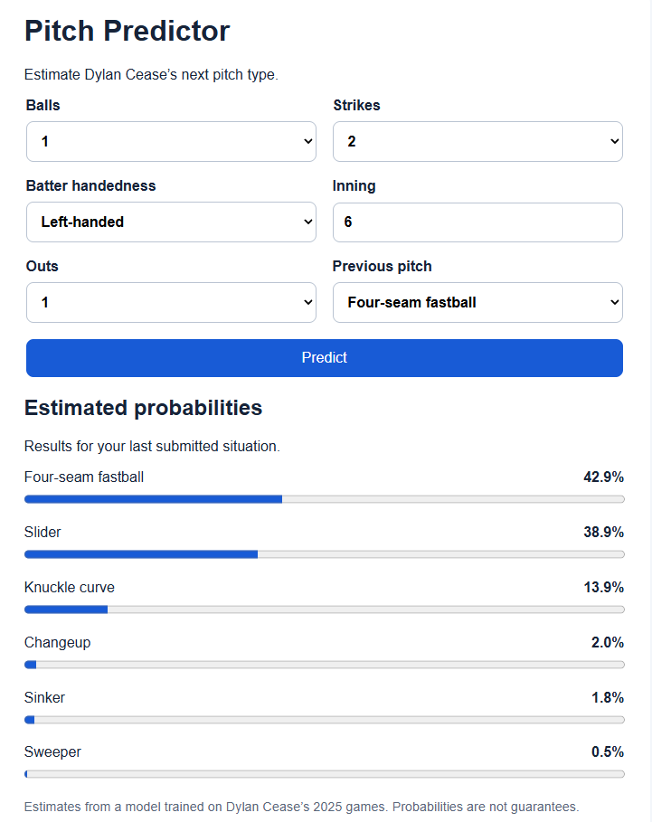

# Pitch Predictor

A machine learning application that estimates Dylan Cease’s next pitch type from the current game situation.

The project includes a React interface, a FastAPI backend, and a reproducible workflow for downloading pitch data, training a model, and evaluating its predictions.

**[Try the live demo](https://pitch-predictor-slfm.onrender.com/)**
The free backend may take about a minute to wake up after inactivity.


## Features

- Predict pitch-type probabilities from:
  - Balls and strikes
  - Batter handedness
  - Inning
  - Outs
  - Previous pitch type
- View ranked probabilities through a web interface or terminal.
- Download and cache MLB Statcast data.
- Train using five seasons of data with greater weight on recent pitches.
- Evaluate predictions chronologically against simple baselines.
- Inspect performance by pitch type, count, and game.

## Tech Stack

| Component | Technology |
| --- | --- |
| Data collection | MLB Statcast through pybaseball |
| Data preparation | pandas |
| Machine learning | scikit-learn |
| Model persistence | joblib |
| Backend | FastAPI |
| Frontend | React, TypeScript, Vite |

## Model

The application uses a recency-weighted random forest with:

- 200 trees
- Maximum tree depth of 6
- Minimum leaf size of 20 samples
- One-hot encoding for batter handedness and previous pitch type
- A fixed random seed for reproducibility

Training uses regular-season pitches from **2022–2026**, with a one-year weighting half-life. A pitch that is 365 days older receives half as much weight.

The current data snapshot was requested through **October 27, 2026**. Training includes available pitches before October 28, 2026. The application does not automatically download live data or retrain.

The saved model is stored locally at:

```text
models/dylan_cease_v2.joblib
```

## Evaluation Results

A retrospective 2026 simulation evaluated **2,895 pitches across 29 games**. Before each game, the updated predictors learned only from pitches on earlier dates.

| Predictor | Accuracy | Log loss ↓ |
| --- | ---: | ---: |
| Frozen random forest | 38.9% | 1.592 |
| Updated random forest | **39.1%** | **1.467** |
| Frozen situational baseline | 38.6% | 1.620 |
| Updated situational baseline | 38.4% | 1.475 |

The situational baseline estimates pitch probabilities using the count and batter handedness, with recency weighting and smoothing.

Accuracy measures how often the most likely pitch matches the actual pitch. Log loss evaluates the full probability distribution; lower values are better.

These results show a modest improvement over the updated situational baseline. They describe the game-by-game simulation, not an independent evaluation of the final model trained on all available data.

The 2026 results were examined during development, so they should be treated as retrospective evidence rather than an untouched final test.

## Project Structure

| Location | Purpose |
| --- | --- |
| `src/api.py` | API routes and request validation |
| `src/pitch_predictor.py` | Load the saved model and produce probabilities |
| `src/predict.py` | Interactive terminal predictions |
| `src/data.py` | Prepare pitch sequences and load training data |
| `src/model.py` | Model configuration, weighting, training, and saving |
| `src/evaluation.py` | Season simulation, baselines, and diagnostics |
| `scripts/data.py` | Download cached data and prepare the training snapshot |
| `scripts/train.py` | Train and save the deployment model |
| `scripts/evaluate.py` | Run evaluation or inspect saved predictions |
| `frontend/` | React interface |
| `data/` | Local datasets and evaluation outputs |
| `models/` | Local saved models |

## Local Setup

### 1. Create a Python environment

Run these commands from the project root:

```bash
python -m venv .venv
```

Activate it on Windows PowerShell:

```powershell
.\.venv\Scripts\Activate.ps1
```

Or on macOS/Linux:

```bash
source .venv/bin/activate
```

Install the Python dependencies:

```bash
python -m pip install -r requirements.txt
```

### 2. Prepare data and train

```bash
python -m scripts.data
python -m scripts.train
```

The data command reuses cached downloads when available and creates:

```text
data/dylan_cease_2022_2026_prepared.csv
```

The training command saves the model to:

```text
models/dylan_cease_v2.joblib
```

Downloading requires internet access. Datasets and model artifacts are not included in the repository.

If you already have the saved v2 model locally, you can skip this step to run the app.

### 3. Start the backend

From the project root:

```bash
python -m uvicorn src.api:app --reload
```

Interactive API documentation is available at:

http://127.0.0.1:8000/docs

### 4. Start the frontend

In a second terminal:

```bash
cd frontend
npm ci
npm run dev
```

Open the local URL printed by Vite.

The frontend development server forwards `/api` requests to the backend on port 8000. Both servers must be running for web predictions.

The development environment used Node.js 24.

## Terminal Predictions

With the Python environment active, run from the project root:

```bash
python -m src.predict
```

Enter the game situation when prompted to receive ranked pitch probabilities.

## Evaluation

Run the chronological simulation and prediction diagnostics:

```bash
python -m scripts.evaluate
```

Inspect existing evaluation outputs without retraining the simulation models:

```bash
python -m scripts.evaluate --diagnostics-only
```

Evaluation produces:

- `data/season_simulation_summary.csv`
- `data/season_simulation_by_game.csv`
- `data/season_simulation_predictions.csv`
- `data/diagnostics_by_count.csv`

Evaluation does not overwrite the application’s saved model.

## Frontend Checks

Run from the `frontend` directory:

```bash
npm run build
npm run lint
```

## Automated Tests

Install development dependencies and run the tests:

```bash
python -m pip install -r requirements-dev.txt
python -m pytest -q
```

Tests cover pitch sequencing, duplicate detection, recency weighting,
API responses, invalid inputs, and missing-model handling.

## Limitations

- The current application supports Dylan Cease only.
- Batter handedness is included, but individual batter identity is not.
- The model’s most likely predictions strongly favor fastballs and sliders.
- Estimates for less common pitches and rare counts can be unreliable.
- Pitch probabilities have not been established as calibrated.
- Pitcher tendencies can change over time.
- Dependency versions and revisions to source data can affect retraining results.

## Possible Next Steps

- Support additional pitchers and individual batter information.
- Evaluate on newly available games.
- Improve probability estimates for less common pitches and rare counts.
- Improve reproducibility through dependency pinning and dataset versioning.
- Deploy the frontend and backend.

## Data Source

Historical pitch data comes from
[Baseball Savant’s Statcast database](https://baseballsavant.mlb.com/statcast_search),
retrieved using [pybaseball](https://github.com/jldbc/pybaseball).

Field definitions are available in the
[Statcast CSV documentation](https://baseballsavant.mlb.com/csv-docs).